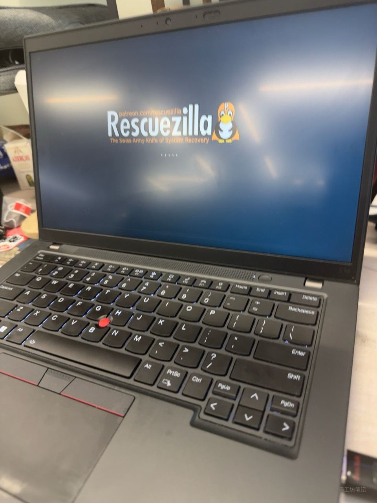
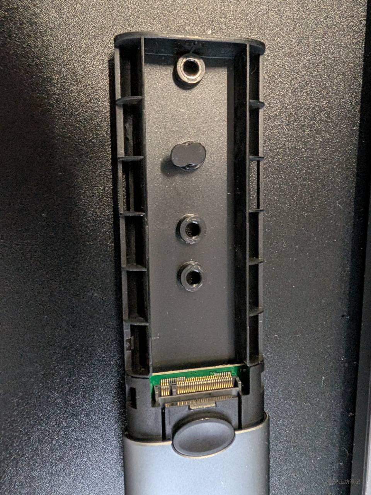
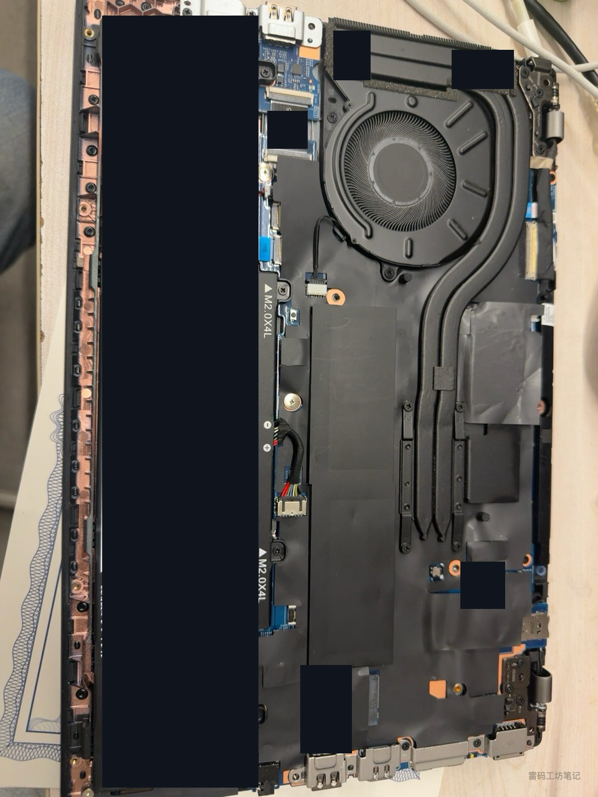
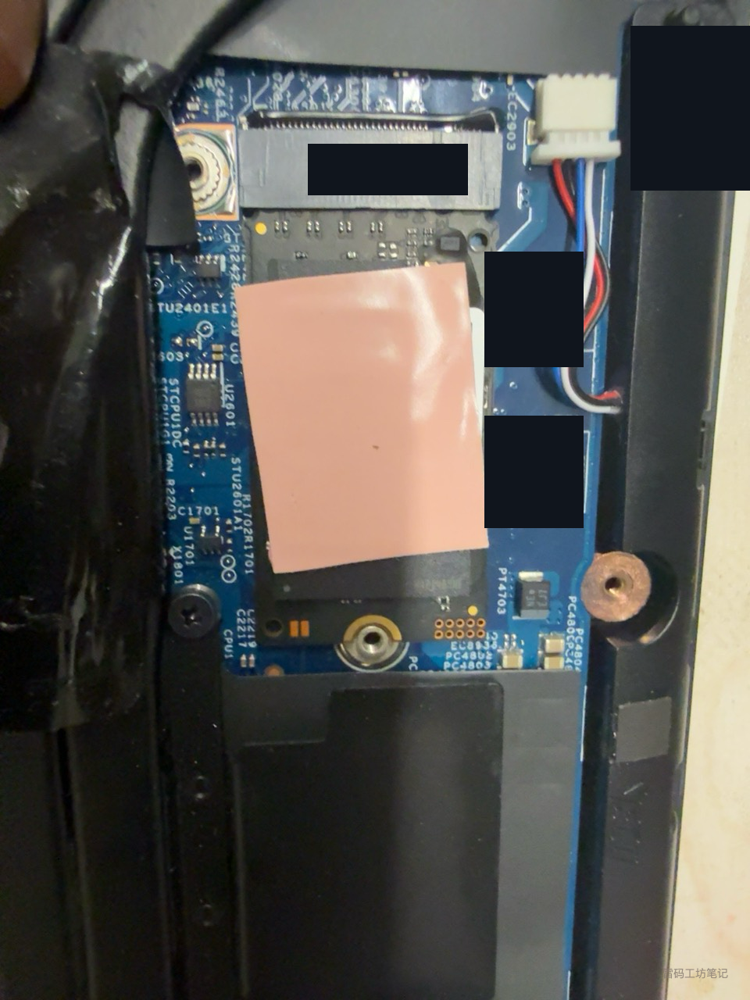

# 我把 ThinkPad 从 256GB 升到 1TB，拆机时被 AI 指错了位置



现场照片，老雷摄。看到 Rescuezilla 标志只能说明处于启动画面，不能据此确认桌面已经就绪或克隆已经开始。

硬盘插在电脑里，却怎么也拔不出来。

在这之前，AI 已经指错过一次位置。我揭开它说的黑色薄膜，发现下面根本没有硬盘。膜快撕坏了，它又开始根据下一张照片判断该往哪儿拉。

我在对话里说：“你给我网上找找攻略啊，别在这里猜了。”

当时克隆和读取校验已经完成，动手拆机却出了岔子。

最后，1TB SSD 成功启动了 Windows，原来的系统和开发工具也保留了下来。

记录日期：2026 年 11 月 17 日。当天完成首次启动和基础验收，7 天稳定性观察尚未结束。本文是这一台机器的实操记录，不代表其他 ThinkPad 的拆装方式。

文中照片均为本次操作中我拍摄的实物。标签、二维码等采用实色遮挡，图片已清除相机元数据；黑块是脱敏标记，不代表硬件本来的外观。

### 我想保住原来的 Windows

这台电脑是 ThinkPad L14 Gen 3 Intel，21C2 类型，i5-1245U、32GB 内存，原装三星 256GB NVMe SSD，运行 Windows 11 专业版。

我希望把容量扩大，保留系统、软件、账号和开发环境，不重装 Windows。因此采用的路线是：旧盘继续留在机器里，把新盘装进 USB 硬盘盒，从 U 盘启动维护系统，将旧盘整盘克隆过去，验证完成后再拆机换盘。

下面是本次用到的实物。硬盘盒后来出了兼容性问题，别把这份记录当成采购推荐。

| 部件 | 本次实际使用 | 需要核对的地方 |
| --- | --- | --- |
| 新 SSD | WD PC SN740 1TB，M.2 2242 NVMe | 尺寸、协议、容量、来源和健康记录 |
| 硬盘盒 | GODO NVMe USB 硬盘盒 | 支持 2242 固定，实际传输和 Linux 兼容性 |
| 启动盘 | SanDisk 32GB U 盘 | 制作时会清空，不能选错设备 |
| 工具 | 合适的十字螺丝刀、塑料撬片 | 不用金属工具在主板上试探 |
| 软件 | Rescuezilla 2.6.2、Rufus 4.15 | 从官方渠道下载，核验文件 |



现场照片，老雷摄。硬盘盒内部的插槽与固定位置，照片拍摄时尚未装入 SSD。

2242 表示约 22 毫米宽、42 毫米长。接口看着相似，也不能据此认定 SATA 和 NVMe 可以混用，更不能把长短不同的盘硬装进支架。先查准确机型的手册，再选配件。

我当时说电脑里没什么重要文件，但保留系统和软件本身就有价值。读者照做前，仍应把重要文件独立备份到另一台设备，并实际打开看看。新盘和旧盘都在同一次操作中，克隆不能替代独立备份。

### 到货先验盘，健康度 100% 不等于全新

新盘还没写入系统时，我们先在 Windows 下检查了型号、容量和 SMART 记录。

这块 WD 的健康检查通过，介质错误为 0，磨损指标显示 0%。但它已有约 148 小时通电，以及数 TB 的累计读写记录，不能称作全新盘。

我会一起看这些数据：型号与容量是否符合订单，累计读写量、通电小时和次数是否符合卖家的描述，有没有介质错误、异常增长的错误记录。“健康 100%”无法证明使用历史为空。

还有个容易混淆的地方：USB 硬盘盒可能返回桥接芯片的序列号，和 SSD 原生序列号不同。核对磁盘身份时，要把型号、容量和连接方式一起看，必要时使用支持该桥接芯片的检测方式。不能只凭一个名字认盘。

读不到 SMART，就保留“没读到”的结论。

### 启动盘先用原版，自动化留到桌面能用以后

我们从官方发布页下载 Rescuezilla ISO，核对 SHA256，再用 Rufus 制作启动 U 盘。启动盘制作会覆盖数据，点开始前必须确认是那只允许清空的 U 盘。

本次还比对了 U 盘上的系统镜像、内核、初始内存盘和 EFI 启动文件与 ISO 的哈希。文件写对了，接下来还得实机启动一次。

Rescuezilla 下载入口：https://rescuezilla.com/download

Rufus 官网：https://rufus.ie/

这里第一次走了弯路。为了尽量让我少输入命令，AI 改了启动菜单，尝试让 Live 系统开机后自动联网并启动 SSH。结果启动报了 `kernel-command-line.service` 配置错误，网络也没有按计划起来，屏幕一度停在 Rescuezilla 启动画面。

当时还没有开始克隆。回到 Windows 后，我们恢复原版启动配置，重新进入了正常桌面。

以后我会先用原版镜像启动成功，确认键盘、触摸板、网络和磁盘都正常，再考虑远程接管。这次把启动、联网和自动执行放在一起，反而增加了排错的麻烦。

Rescuezilla 官方另有针对图形启动黑屏的建议，包括尝试 Graphical Fallback Mode；但这次看到的自定义启动项错误，不能直接归结为显卡问题。黑屏只是现象，要看日志和当前是否已经开始写盘。

官方帮助：https://rescuezilla.com/help

### Windows 能远程连，不代表维护系统也能连

原来的 Windows 配好了 Tailscale 和 SSH。电脑从 U 盘启动 Rescuezilla 后，运行的已经是另一套系统，Windows 中的远程服务不会继续替它工作。

我们在 Live 环境重新联网，安装并启动临时 SSH，才从 Mac 连了进去。Rescuezilla 的这些临时安装通常随重启消失，写到 U 盘上的脚本和网络配置则会留下来。

远程协助前，要实测 Live 环境能连接，接好电源并避免休眠。离开现场之前，约定谁能重启和启动写盘。

我也踩了手工输命令的坑。有一次把带管道的长命令输错，空格、路径和分隔符混在一起，终端报 `command not found`。后来改为运行已经准备好的脚本，输入才简单下来。

文章不提供当时的联网脚本，因为里面涉及机器路径、网络配置和临时授权。迁移结束后，这类文件应该清理，不能把带 Wi-Fi 密码的启动 U 盘当普通工具随手借人。本次收工时 U 盘已拔出，其中临时联网文件尚待下次接入时清理。

### 硬盘盒在 Windows 正常，进 Linux 却会卡

新 SSD 在 Windows 下能识别，也完成了健康检查。进入 Linux 后，通过硬盘盒查询 SMART 却出现挂起，日志里能看到 USB/UAS 重置。

UAS 是 USB 存储的一种传输方式。我们针对这只桥接设备临时禁用 UAS，改走 `usb-storage`，随后做了一次 64MiB 直接读取测试，通过后才开始克隆。克隆过程中没有继续查询它的 SMART。

Linux 内核文档把 `usb-storage.quirks` 的 `u` 标志定义为忽略 UAS。这个机制确实存在，但不意味着遇到任何慢盘都该改它。

内核参数说明：https://docs.kernel.org/admin-guide/kernel-parameters.html

如果遇到相似现象，先核对日志、连接口、线材和桥接芯片，再决定是否需要兼容性处理。不要在克隆正在写入时切换驱动、拔插硬盘盒，或者继续发会让它挂起的检测命令。

这次实际链路只有 480Mbps，持续传输约每秒 30MB。硬盘盒商品页标的 10Gbps，没有变成这次连接的实际速度。为什么只协商到这个速度，没有继续查清。

界面最初还出现过很高的短时速度，其中有内存缓存的影响。最终克隆约用了 50 分钟。估时要看持续速度和实际复制量，还得留出最终同步的时间。

### 克隆前，把“从哪里来，写到哪里去”写清楚

这一步会覆盖目标盘。本次方向是：

旧三星 256GB，电脑内置，作为源盘。

新 WD 1TB，USB 硬盘盒连接，作为目标盘。

32GB U 盘只负责启动维护系统。

在维护系统里，我们通过型号、实际容量、序列号和连接方式重新确认了三块盘，并将旧盘及其分区设为本次运行期间只读，作为额外保护。

`/dev/sda`、`/dev/sdb` 这样的设备名可能随启动和插拔变化。不能拿教程或上次开机的设备名替代现场确认。Linux 下可以先用下面的只读命令看清设备，再决定是否继续：

```bash
lsblk -o NAME,SIZE,MODEL,SERIAL,TRAN,FSTYPE,MOUNTPOINTS
```

进入维护系统前，应让 Windows 完整重启，别在休眠或混合关机留下的 NTFS 状态上强行写入。遇到休眠、脏卷或文件系统错误提示，要先回到 Windows 核实并处理。

本次 Windows 系统盘是 GPT 布局，包含 EFI 启动分区、MSR 保留分区、Windows 分区和恢复分区。我们复制了整盘布局，没有只复制 C 盘里的文件。

原盘的 BitLocker 当时已完全解密、保护关闭。如果你的盘处于加密状态，先保存并确认恢复密钥可用，核对当前工具对这种状态的支持，再决定操作路径。不要拿本文这次未加密的结果，推断所有加密盘都能照搬。

最终克隆使用了 Rescuezilla Live 环境中的 Clonezilla 命令行工具 `ocs-onthefly`。用到 `-k1` 和 `-r` 处理目标分区与文件系统扩容，克隆日志显示四个分区完成，Windows 分区扩容成功。

Clonezilla 官方对这些参数的说明：https://clonezilla.org/clonezilla-live/doc/03_Disk_to_disk_clone/advanced/05-advanced-param.php

这里不放一条硬编码源盘、目标盘并自动确认的写盘命令。它在这台机器上运行成功，复制到另一台机器上却可能覆盖错盘。开始前要人工核对源和目标。

扩容结果也必须实测。本次使用的版本保留了小分区的尺寸，把主要新增空间留给 C 盘。不能只看参数描述，就认定所有版本、所有布局都会得到同样的结果。

### 进度到 100%，还要做哪些检查

克隆中屏幕变黑，可能只是屏幕节能，不能仅凭黑屏判定死机。先通过日志和任务状态确认，写盘期间不要直接断电或强制重启。

我们等到克隆退出码为 0、最终同步完成，才开始验证。下面这些检查解决的问题不同，不能互相替代。

| 检查 | 本次结果 | 能说明什么 |
| --- | --- | --- |
| GPT 结构及分区类型 | 检查通过，四个分区保留 | 分区表没有报告结构错误 |
| EFI 文件系统、Windows 和恢复分区 | 只读检查通过 | 当时没有发现相应结构异常 |
| MSR 分区 | 16MiB 内容逐字节一致 | 该分区复制内容一致 |
| 启动文件、注册表和部分工具文件 | 源与目标 SHA256 一致 | 抽查的这些文件内容相同 |
| C 盘文件系统容量 | 约 952.73GiB | 扩容已落实到文件系统 |
| 新盘独立启动 | 换盘后进入 Windows | 新盘实际具备启动能力 |

抽查包括 Windows 启动文件、SYSTEM/SOFTWARE 注册表文件、用户注册表、EFI 启动文件、BCD、恢复镜像，以及 Git 和 Node 可执行文件。抽查只覆盖这些文件，其他软件还要实际打开验证。整块盘没有做逐扇区比对。

NTFS 的只读快速检查同样不能说成完成了 Windows 的全盘修复扫描。

校验还留下了一个值得如实记录的问题：GPT 工具提示 C 盘结束位置、恢复分区起止位置没有全部对齐到 4KiB 边界。C 盘起点已经对齐，结构检查没有报告 GPT 错误，之后启动和恢复环境查询通过。我们没有为了消除提示，再移动已克隆好的恢复分区。

这不代表对齐提示可以永远忽略。以后启用磁盘加密或调整分区前，要重新评估。

标称容量和 Windows 显示值也容易让人误会。这次 SSD 实际容量约 1.024 万亿字节，约 953.87GiB，扣除几个小分区后，C 盘约 952.73GiB。Windows 界面常把这个数标成 GB。核对时要看实际字节数、分区结构和文件系统容量，不能只拿“1TB”与界面数字直接相减。

### 拆机前先查准确机型，别让 AI 根据黑膜猜位置

这次最不应该发生的错误，出在拆机指导。

底盖打开后，AI 把某处黑色绝缘膜下面的位置判断为 SSD。我照着揭开，发现位置不对，薄膜也已经受损。它随后又根据照片推断硬盘该怎么抬、往哪个方向抽。我反馈拔不动，并要求先找网上攻略。

后来查到联想官方 Hardware Maintenance Manual，才看清手册区分了 DIS 和 UMA 两种布局。这台机器对应的 UMA 布局里，SSD 在风扇附近、靠转轴、热管上方的覆盖区域。动手前，仍需把手册图与自己的整块主板对应。



现场照片，老雷摄，已脱敏。这是当时打开底盖后的全景，用来对照主板布局，不把某块黑膜的位置直接当作 SSD 拆卸指示。

官方维修手册：https://download.lenovo.com/pccbbs/mobiles_pdf/l14_l15_gen3_hmm_en.pdf

本次核对版本为 2023 年 8 月第三版，印刷页 72 至 74 是 2242 SSD、支架和导热垫相关步骤，其中印刷页 73 对照了 DIS/UMA，PDF 文件页为 79。其他版本请以章节名为准。

21C2 官方自助维修入口：https://pcsupport.lenovo.com/gb/en/products/laptops-and-netbooks/thinkpad-l-series-laptops/thinkpad-l14-gen-3-type-21c1-21c2/21c2/selfrepair/removalsreplacements

联想官方 SSD 更换视频：https://www.youtube.com/watch?v=z7ADl-p8P9Y

当时找到了适用机型的视频链接，但远程工具没能播放并核实动作，无法凭这个链接确认卡扣应该怎么推。

硬盘为什么在那个位置卡住、黑色部件究竟是否需要移动，并没有核实。后来虽然现场完成了更换，这里也不能补写一套没有记录的拆卸动作。这部分请按适用机型的官方步骤核对，拿不准就停下，找现场维修人员确认。



现场照片，老雷摄，已脱敏。粉色软垫当时仍贴在 SSD 上，盖板已经取下。照片不能证明插槽的拆卸动作，也不能据此确定哪个黑色部件需要推动。

断电准备则有明确手册可查：拔掉外接电源，进入 BIOS，按该机型流程选择 `Config → Power → Disable Built-in Battery → Yes`，机器自动关闭，等待 3 至 5 分钟，并移除外设。禁用内置电池后不要再次接电，直到拆装结束。

用户指南：https://download.lenovo.com/pccbbs/mobiles_pdf/l14_l15_gen3_ug_en.pdf

有无 SIM 卡托、是否插着 microSD 卡，也要先对照实机和手册核对。这台机器现场没有找到 SIM 卡托，不能因为某段通用教程提到了，就反复找一个不存在的部件。松开底盖螺丝后，按适用机型的卡扣顺序打开；遇到阻力先查固定件，不继续用力撬。

拆之前拍完整内部照片，记录薄膜、导热垫、铜色盖板和固定件原本的位置。复装按对应结构恢复，不能把软导热垫当包装撕掉，也不能用随手找到的普通胶带替代绝缘材料。膜已经破损、盖不回去或疑似露出导电部位时，应先确认处理办法再通电。

本次没有取得足够照片证据独立确认受损膜的最终状态。后面能够开机，只能证明当时启动成功，不能替代绝缘与机械复装检查。

### 换完第一次开机，只接电源

验证结束后先完整关机，再更换 SSD。首次从新盘启动时，我拔掉启动 U 盘和 USB 硬盘盒，不连接旧盘，只接电源开机。

确认新盘能独立启动后，再连接其他存储设备。

进入 Windows 后，我们远程核对了磁盘与系统状态。下面是管理员 PowerShell 中的只读自查命令。磁盘加密查询命令是否可用取决于系统版本。

```powershell
# 确认当前磁盘的型号、容量和健康状态
Get-Disk | Select-Object Number,FriendlyName,Size,HealthStatus

# 查看 C 盘容量和剩余空间
Get-Volume -DriveLetter C | Select-Object DriveLetter,Size,SizeRemaining,HealthStatus

# 查看 Windows 恢复环境状态
reagentc /info

# 查看 Windows 激活有效期
cscript.exe //Nologo "$env:windir\System32\slmgr.vbs" /xpr

# 查看加密状态，不会开启或关闭加密
Get-BitLockerVolume -MountPoint C: | Select-Object VolumeStatus,ProtectionStatus
```

本次确认了 WD SN740 是当前系统盘，C 盘约 953GB、空闲约 868GB，磁盘状态正常，Windows 显示永久激活，WinRE 已启用。Git 和 Node 也实际运行并输出了版本号。

常用软件还需要自己打开，登录状态、项目路径、编译和日常使用也得分别验证。我们把旧盘完整保留，计划至少观察 7 天。以后擦除或出售旧盘，也应先确认新系统稳定、重要数据有独立备份，并妥善处理旧盘上的个人信息。

### 启动后还有两件事，不能都怪新硬盘

一件是时间。

我看到联想显示 9 点多，当地实际已经是下午 5 点多。检查发现时区已是北京时间，但 Windows 时间服务停止、启动类型为手动。

启动服务后，时钟恢复到正确时段，第一次重同步仍报没有可用数据。配置时间源并重启服务后，同步成功。我们回读了当前时间、最后成功同步时间和服务状态，确认服务运行且设为自动启动。

如果需要排查，可以先在管理员 PowerShell 查看：

```powershell
Get-Date -Format o
Get-TimeZone
Get-Service W32Time
w32tm /query /status
```

只有确认时间服务需要恢复时，再设置自动启动、启动服务并请求同步：

```powershell
Set-Service W32Time -StartupType Automatic
Start-Service W32Time
w32tm /resync /rediscover
```

如果报没有可用时间数据，要继续排查时间源和网络，并再次查询状态。属于公司管理的电脑，先遵循管理员的时间策略，不随便改域内配置。

Windows 和 Linux 对硬件时钟的处理差异，是八小时时差的一种可能解释。但本次没有足够证据把它确定为根因，因此也没有直接修改 RTC 相关注册表。

微软时间服务说明：https://learn.microsoft.com/en-us/windows-server/networking/windows-time-service/windows-time-service-tools-and-settings

另一件是触摸板。

换盘后我觉得指针跟不上手。检查时系统负载很低，触摸板也能识别。拔掉充电器，用电池试，立刻恢复跟手。

问题与接电状态有关，具体是充电器、插座、供电干扰还是机身接地问题，尚未定位。我们没有改触摸板参数，也没有据此宣布硬件故障。这个问题暂时搁置，后面还应做同充电器换插座、同插座换兼容充电器的对照。

### 下次我会把这些放在开始之前

- 先记录准确机型、主板布局、旧盘分区和加密状态，重要文件另做备份。
- 新盘到货先验型号、实际容量和 SMART，使用历史与健康指标分开看。
- 原版维护系统先实机启动成功，再加远程控制或其他自动化。
- 每次启动后重新确认源盘、目标盘和启动 U 盘，目标盘上的数据会被覆盖。
- 硬盘盒报错先停下来排查，稳定读取通过后再写入，写盘中不拔插、不换驱动。
- 克隆结束后等同步完成，检查分区、文件系统、关键文件，再关机换盘。
- 拆机先对照准确机型的官方图，不按“黑膜下面应该有东西”动手，拔不动时不加力。
- 复装检查绝缘与导热材料，首次新盘启动拔掉其他启动设备，验证容量、激活、恢复环境和常用软件。
- 保留旧盘和独立备份，清理维护 U 盘上的网络凭据，观察稳定后再处理旧盘。

现在这台联想已经从新盘进了 Windows，原来的开发工具还能运行。旧盘继续留着，触摸板接电迟滞的问题待查，稳定性观察也还在继续。

### 关于作者

老雷（Andy），明道云 & Nocoly CMO，SaaS 行业从业十余年。骨子里是个技术迷，乔布斯的信徒，相信好的产品能改变世界。深度关注 AI、商业与科技趋势，目前在深度使用和实践 Claude Code，专注探索 AI 如何重塑产品形态和商业逻辑。不聊概念，只聊真实发生的事。
